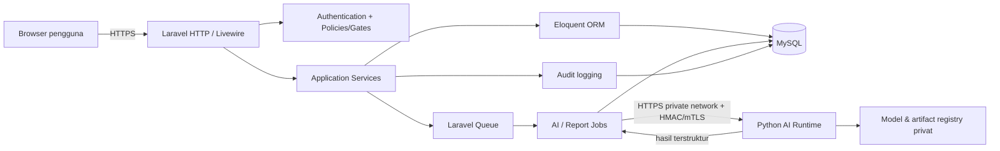

# System Architecture — StockWise AI

## 1. Keputusan arsitektur

StockWise AI menggunakan **Laravel monolith modular** sebagai sistem utama. Laravel menangani authentication, authorization, UI, workflow, database, aturan stok, aturan restock, audit, dan orkestrasi pekerjaan. Modul Python hanya menangani training/inference model serta perhitungan SHAP; Python tidak memiliki akses langsung ke database produksi dan tidak menjadi backend utama.

Keputusan ini menjaga satu sumber kebenaran untuk stok dan keputusan, tetapi tetap memisahkan lifecycle AI yang membutuhkan library dan runtime berbeda.

## 2. Komponen logis

### Lapisan Laravel

- **Blade:** shell layout, halaman server-rendered, fallback/error/print view, dan komposisi komponen.
- **Livewire:** stateful interaction untuk tabel/filter/form/dashboard tanpa membangun SPA; tetap melewati authorization dan validation server-side.
- **Controller:** adapter tipis untuk route HTTP, binding, response/redirect; tidak memuat aturan stok atau perhitungan restock.
- **Form Request:** authorization awal dan validasi input terstruktur.
- **Service:** orkestrasi use case seperti `StockTransactionService`, `ForecastService`, dan `RecommendationService`; menjadi batas transaction database.
- **Eloquent:** model, relationship, scope, cast, dan query terparameterisasi; bukan tempat untuk workflow lintas aggregate yang kompleks.
- **MySQL:** sumber kebenaran transaksi, saldo, metadata forecast, approval, dan audit.
- **Policies/Gates:** pemeriksaan izin berdasarkan user, role, dan resource; diterapkan pada route, controller, dan Livewire action.

Alur request normal: route → middleware/auth → Policy/Form Request → Controller atau Livewire action → Service → Eloquent/MySQL → response Blade/Livewire.

## 3. Batas modul

Modul utama Laravel:

1. Identity & Access
2. Dashboard & Reporting
3. Master Data
4. Inventory & Stock Transactions
5. Demand History
6. Forecast Orchestration
7. Explainability
8. Restock Decision Support
9. Approval
10. Audit

Setiap modul memiliki use case dan authorization sendiri. Modul AI tidak boleh mengubah saldo inventory secara langsung.

## 4. Python AI runtime

Python dipaketkan terpisah (misalnya direktori `ai/` atau repository deployment terpisah) dengan tanggung jawab:

- training offline/terjadwal dari dataset yang sudah diekspor dan disetujui;
- validasi temporal, evaluasi baseline, dan penyimpanan model/version metadata;
- inference forecast berdasarkan kontrak input terversi;
- perhitungan SHAP dan serialisasi penjelasan yang dibatasi ukuran;
- health/version endpoint internal tanpa data sensitif.

Python tidak melakukan authentication pengguna, tidak menerapkan approval, tidak menulis tabel MySQL produksi, dan tidak menghitung saldo stok. Aturan restock menerima output forecast di Laravel agar rule bisnis dapat diaudit dan diuji independen dari model.

## 5. Komunikasi Laravel–Python yang aman

Desain default adalah private internal service, bukan endpoint publik:

- Laravel mengirim request hanya dari Queue worker melalui private network/localhost.
- Endpoint memakai HTTPS; produksi menggunakan mTLS atau service identity dan secret dikelola di environment/secret manager.
- Request memiliki `request_id`, timestamp, nonce, schema version, dan HMAC signature untuk mencegah replay/tampering.
- Payload hanya berisi data minimum yang diperlukan; tidak mengirim password, session, atau token pengguna.
- Python memvalidasi schema, ukuran payload, rentang nilai, model/version, dan idempotency key.
- Timeout, retry terbatas dengan exponential backoff, circuit breaker sederhana, dan dead-letter handling mencegah queue macet.
- Response ditandatangani/divalidasi, memiliki status (`success`, `insufficient_data`, `invalid_input`, `model_error`), model version, metrics, dan trace id.
- Laravel menyimpan raw request besar/artifact di storage privat dengan retention policy; database menyimpan metadata dan hasil terstruktur.

Untuk tahap awal, inference juga dapat dijalankan sebagai Python CLI lokal oleh job worker dengan input/output file privat. Kontrak data tetap sama sehingga migrasi ke service internal tidak mengubah domain Laravel. FastAPI tidak digunakan sebagai backend utama.

## 6. Queue dan lifecycle AI

1. `PrepareForecastDatasetJob` mengambil snapshot data historis yang telah divalidasi.
2. `RunForecastInferenceJob` mengirim snapshot ke Python dan menyimpan hasil secara idempotent.
3. `GenerateForecastExplanationJob` menyimpan faktor SHAP untuk forecast yang sukses.
4. `BuildRestockRecommendationsJob` menjalankan aturan restock Laravel dari forecast yang eligible.
5. `GenerateReportJob` membuat ekspor berat secara asynchronous.

Job memiliki unique key berdasarkan produk/periode/model/run, retry terbatas, timeout, status progress, dan failed-job record. Job hanya menandai data sebagai sukses setelah transaction penyimpanan selesai. Approval tidak dijalankan otomatis oleh queue.

## 7. Konsistensi dan observability

- Perubahan stok menggunakan transaction MySQL dan row lock pada `inventories`.
- Queue menyimpan correlation ID yang sama dengan audit log dan request AI.
- Log terstruktur menyimpan durasi, status, job ID, model version, dan error code; bukan secret atau payload sensitif penuh.
- Metrics minimal: latency request, failed jobs, forecast eligible rate, inference error rate, stock adjustment, dan approval cycle time.
- Backup database, encryption in transit, retention artifact, dan recovery objective harus ditetapkan sebelum production.

## 8. Risiko desain

- Private AI service menambah deployment/monitoring; CLI fallback mengurangi kompleksitas awal tetapi kurang cocok untuk throughput besar.
- Forecast dan XAI dapat stale setelah transaksi baru; setiap hasil harus memiliki `data_as_of` dan status freshness.
- MySQL menjadi pusat konsistensi, tetapi laporan besar harus memakai index, pagination, dan queue agar tidak mengganggu transaksi.
