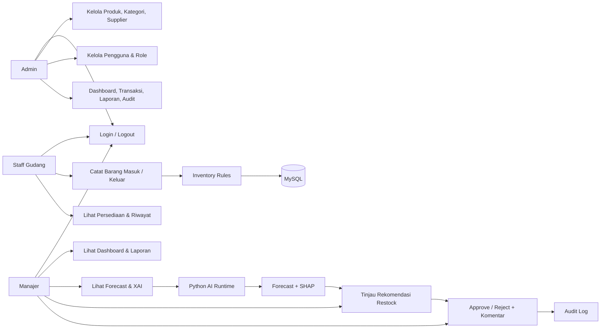
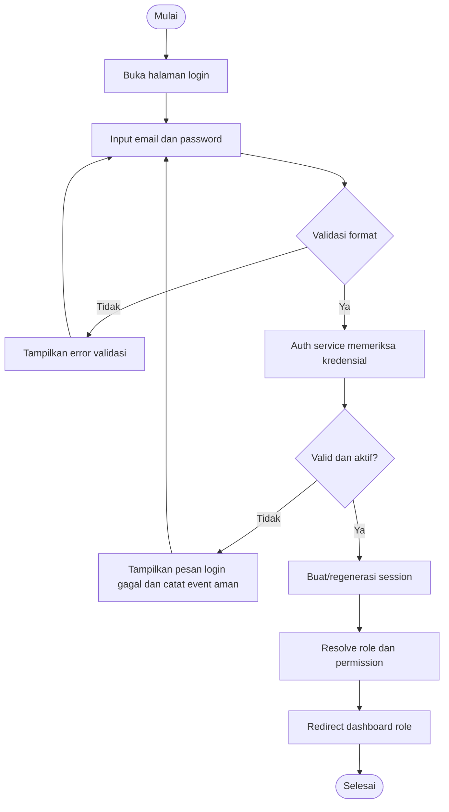
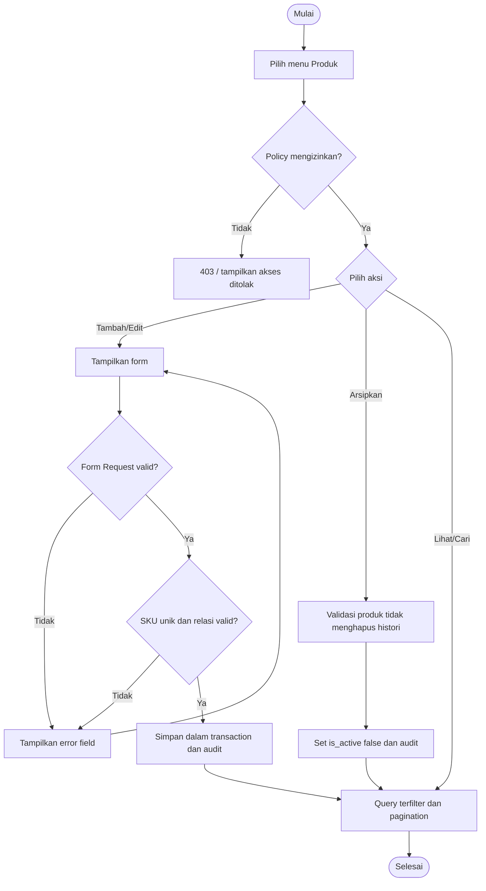
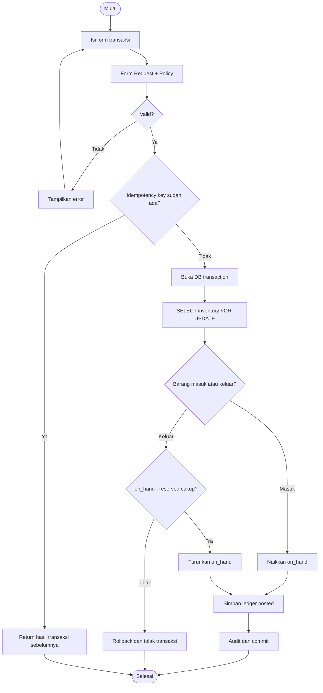
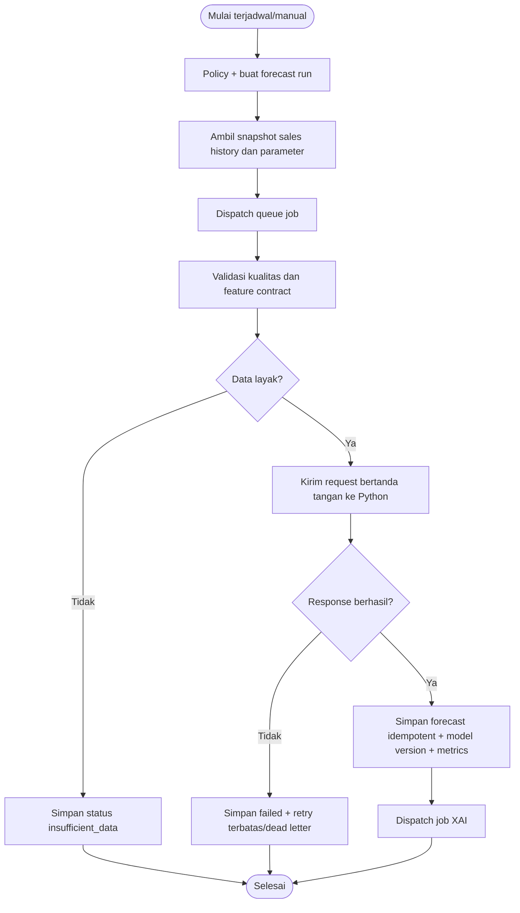
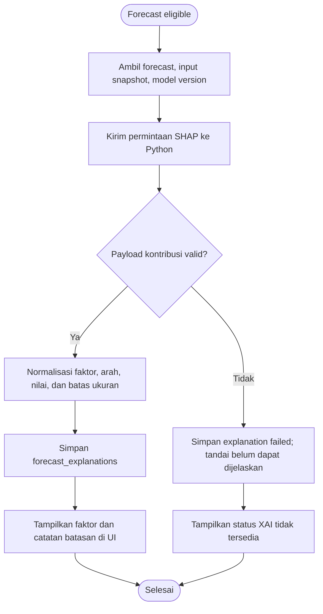
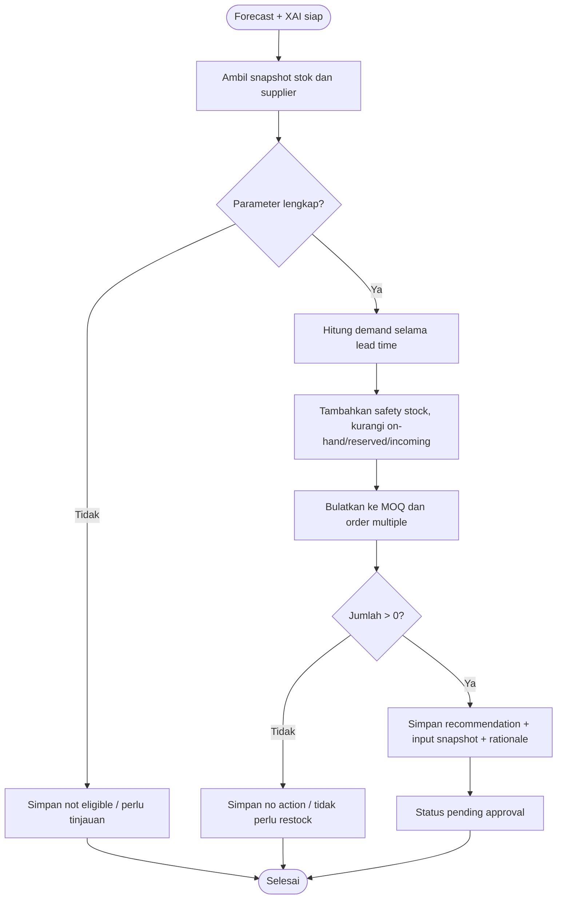
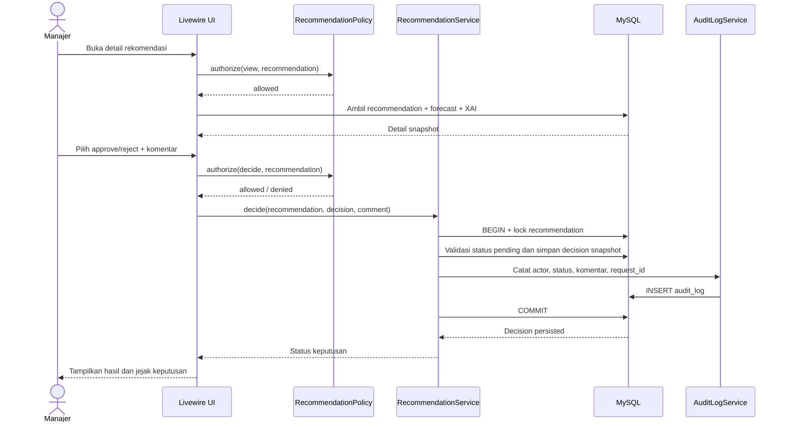

# System Diagrams

Semua diagram berikut menggunakan Mermaid dan dapat dirender oleh dokumentasi yang mendukung Mermaid.

## 1. Use Case Diagram (representasi Mermaid)

## 2. Activity Diagram Login

## 3. Activity Diagram CRUD Produk

## 4. Activity Diagram Barang Masuk/Keluar

## 5. Activity Diagram Forecasting AI

## 6. Activity Diagram Explainable AI

## 7. Activity Diagram Rekomendasi Restock

## 8. Sequence Diagram Approval Manajer

## 9. Batasan diagram

Diagram menggambarkan alur konseptual, bukan kontrak route atau schema final yang sudah diimplementasikan. Detail field dan constraint berada di `docs/database.md`; detail modul berada di `docs/module-structure.md`.
